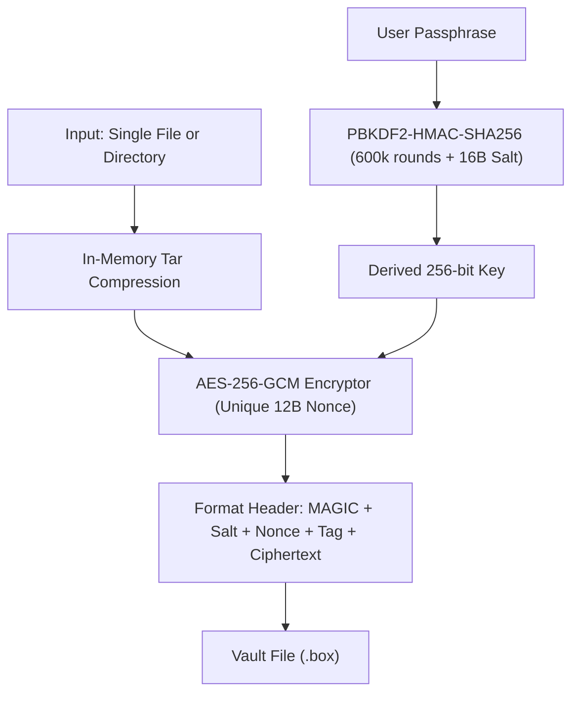

# cryptbox-cli

[](https://pypi.org/project/cryptbox-cli/)
[](https://pypi.org/project/cryptbox-cli/)
[](https://github.com/uchiha-fire/cryptbox-cli)
[](LICENSE)
[](https://zephyrus-labs.tech/)

A zero-trust authenticated file and directory vault using military-grade AES-256-GCM authenticated encryption by **[Zephyrus Labs](https://zephyrus-labs.tech/)** for Linux, macOS, and Windows.

---

## Features

- 🔒 **Military-Grade AES-256-GCM (AEAD)**: Complete confidentiality and cryptographic tamper-evidence in a single cipher.
- 🛡️ **Zero-Trust Integrity Verification**: If even a single byte of the `.box` vault is corrupted or modified, decryption aborts immediately with zero partial files written to disk.
- 🔑 **OWASP 2024 Key Derivation**: PBKDF2-HMAC-SHA256 with 600,000 rounds and a cryptographically secure 16-byte random salt.
- 📁 **Seamless File & Directory Archiving**: Locks single files or entire nested folder trees into a portable, compressed `.box` vault.
- 🔍 **Safe Header Inspection**: Inspect vault metadata (format, salt length, cipher, payload size) without entering a password.
- 🛡️ **Zip/Tar Slip Protection**: Enforces path containment to prevent directory traversal exploits during extraction.
- 🧙 **Interactive Security Wizard**: Intuitive terminal workflow with hidden passphrase entry and verification.

---

## Architecture & Binary Vault Specification

```text
+----------------+---------------+---------------+---------------+----------------------+
| Magic (8 bytes)| Salt (16 B)   | Nonce (12 B)  | Tag (16 B)    | Ciphertext (N bytes) |
| b"CRYPTBOX"    | Random Salt   | GCM Nonce     | GCM Auth Tag  | AES-256-GCM Payload  |
+----------------+---------------+---------------+---------------+----------------------+
```



---

## Installation

```bash
pip install cryptbox-cli
```

Or install the latest development build directly:

```bash
pip install git+https://github.com/uchiha-fire/cryptbox-cli.git
```

---

## Interactive Mode

Run `cryptbox` without arguments or pass `--interactive` to launch the terminal wizard:

```bash
cryptbox
```

```text
╔══════════════════════════════════════════════════════════════╗
║               cryptbox-cli  v0.1.0                           ║
║     Zero-Trust Authenticated Vault (AES-256-GCM)             ║
║     Zephyrus Labs (https://zephyrus-labs.tech/)              ║
╚══════════════════════════════════════════════════════════════╝

Welcome to the cryptbox Security Vault Wizard!

Select Action:
  [1] 🔒 Lock file or directory into encrypted .box vault
  [2] 🔓 Unlock an encrypted .box vault
  [3] 🔍 Inspect vault metadata (No password required)
Choose [1/2/3] (default: 1): 1

Enter path to file or directory to lock: ./sensitive_records
Enter destination .box path (default: sensitive_records.box): sensitive_records.box
Enter passphrase for vault: ********
Confirm passphrase: ********

Deriving 256-bit key (PBKDF2-SHA256) and encrypting AES-256-GCM...
✓ Vault sealed successfully in 0.42s!
✓ Vault file (42180 bytes): sensitive_records.box
```

---

## CLI Usage & Options

```bash
# Encrypt a file or entire directory
cryptbox lock ./confidential_data

# Encrypt to a specific destination
cryptbox lock ./confidential_data -o backup.box

# Unlock an encrypted vault
cryptbox unlock backup.box -o ./restored/

# Inspect vault cryptographic metadata without password
cryptbox inspect backup.box
```

### Options Reference

| Command | Flag | Long Option | Description |
| :--- | :--- | :--- | :--- |
| `lock` | `-o` | `--output` | Destination path for `.box` vault file |
| `lock` | `-p` | `--password` | Passphrase (if omitted, prompts securely without terminal echo) |
| `lock` | `-f` | `--force` | Overwrite destination vault if it already exists |
| `unlock` | `-o` | `--dest` | Destination directory to unpack files into |
| `unlock` | `-p` | `--password` | Decryption passphrase |
| `inspect` | | | Inspect vault header and cipher details |
| *(global)* | `-i` | `--interactive` | Launch interactive wizard |
| *(global)* | `-v` | `--version` | Display package version |

---

## Python API Reference

```python
from cryptbox import lock_path, unlock_vault, inspect_vault

# 1. Lock a directory or file
vault_file = lock_path(
    source_path="./customer_records",
    password="super-secure-passphrase-here",
    output_path="backup.box"
)

# 2. Inspect metadata without password
meta = inspect_vault("backup.box")
print(f"Cipher: {meta['cipher']}, Vault Size: {meta['vault_size']} bytes")

# 3. Unlock vault cleanly
restored_dir = unlock_vault(
    vault_path="backup.box",
    password="super-secure-passphrase-here",
    destination_dir="./restored/"
)
print(f"Successfully extracted to: {restored_dir}")
```

---

## Developed & Maintained by Zephyrus Labs

Built and maintained by **[Zephyrus Labs](https://zephyrus-labs.tech/)**.

- 🌐 Website: [zephyrus-labs.tech](https://zephyrus-labs.tech/)
- 💻 GitHub: [@uchiha-fire](https://github.com/uchiha-fire)
- ✉️ Contact: [zephyrus.labs@gmail.com](mailto:zephyrus.labs@gmail.com)

If you find this tool helpful, please give it a ⭐️ on [GitHub](https://github.com/uchiha-fire/cryptbox-cli)!

---

## Acknowledgements & Attributions

This tool builds upon and credits the exceptional work of open-source projects:

- **[cryptography](https://github.com/pyca/cryptography)**: Industry-standard, audited cryptographic library for Python. Licensed under Apache-2.0 / BSD-3-Clause.

---

## License

This project is licensed under the MIT License - see the [LICENSE](LICENSE) file for details.

---

<p align="right">
  <sub>Lead Developer: <a href="https://www.linkedin.com/in/shubham-sharma-28487819b/">Shubham Sharma</a> (<a href="https://github.com/uchiha-fire">@uchiha-fire</a>) &bull; <a href="mailto:sharmashubham25962@gmail.com">sharmashubham25962@gmail.com</a></sub>
</p>
